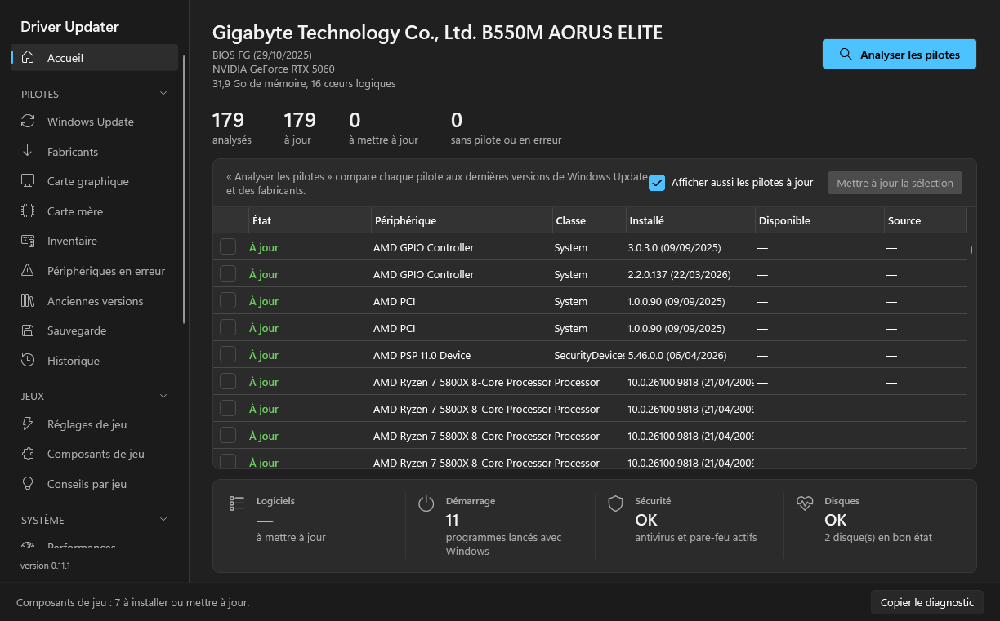
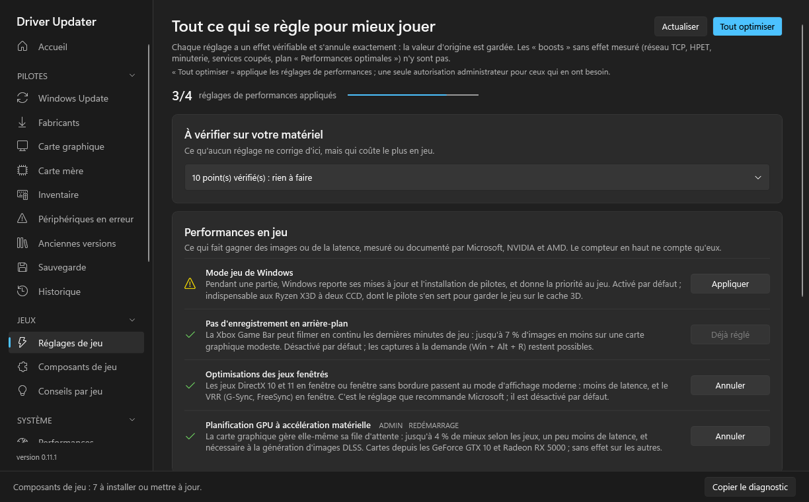

<p align="center">
  
</p>

<h1 align="center">Driver Updater</h1>

<p align="center">
  <strong>Les pilotes et les réglages de ton PC Windows, honnêtement.</strong><br>
  Il ne propose que ce qui marche vraiment, dit pourquoi, et sait revenir en arrière.
</p>

<p align="center">
  <a href="https://github.com/Augaton/driver_updater/releases/latest"></a>
  <a href="https://github.com/Augaton/driver_updater/actions/workflows/build.yml"></a>
  
  
  <a href="LICENSE"></a>
</p>

<p align="center">
  <a href="https://github.com/Augaton/driver_updater/releases/latest"><strong>Télécharger</strong></a> ·
  <a href="#premiers-pas">Premiers pas</a> ·
  <a href="#questions-fréquentes">Questions fréquentes</a> ·
  <a href="SECURITY.md">Sécurité</a> ·
  <a href="CONTRIBUTING.md">Contribuer</a>
</p>

<p align="center">
  <picture>
    <source media="(prefers-color-scheme: light)" srcset="docs/accueil-clair.png">
    
  </picture>
</p>

Driver Updater compare chaque pilote de ton PC à Windows Update, au catalogue Microsoft Update et,
pour une carte NVIDIA, au site de NVIDIA, puis installe ce qui manque en une fois, après un point de
restauration. Il règle aussi Windows pour le jeu, défait les « boosts » que d'autres outils ont
laissés, met tes logiciels à jour et fait le ménage. En français ou en anglais, clair ou sombre
comme Windows.

> Dans l'esprit de Driver Booster, sans ses défauts : pas de « score », pas de nettoyage du
> registre, pas de réglage sans effet mesuré. Chaque réglage s'appuie sur la documentation de
> Microsoft ou des mesures publiées, garde la valeur d'origine et s'annule exactement.

## Sommaire

- [Fonctionnalités](#fonctionnalités)
- [La fenêtre](#la-fenêtre)
- [Installation](#installation)
- [Premiers pas](#premiers-pas)
- [Ce qu'il ne fait pas, exprès](#ce-quil-ne-fait-pas-exprès)
- [Données et réseau](#données-et-réseau)
- [Questions fréquentes](#questions-fréquentes)
- [Désinstaller](#désinstaller)
- [Sécurité](#sécurité)
- [Compiler depuis les sources](#compiler-depuis-les-sources)
- [Architecture](#architecture)
- [Contribuer](#contribuer)
- [Licence](#licence)

## Fonctionnalités

**Pilotes**

- **Une analyse, trois sources** : Windows Update, le catalogue Microsoft Update (les pilotes des
  fabricants, signés par Microsoft) et NVIDIA pour ses cartes. Le rapport donne pour chaque
  périphérique la version installée, la version disponible, sa source et un verdict.
- **Installation en une fois**, sous une seule autorisation, après un point de restauration créé
  juste avant. Les pilotes « facultatifs » de Windows Update ne sont pas cochés, et ceux du
  stockage ne sont jamais installés depuis le catalogue : un mauvais pilote à cet endroit empêche
  Windows de démarrer.
- **Une source injoignable ne fait jamais passer un pilote pour « à jour »** : l'analyse se dit
  incomplète, et un périphérique qu'aucune source n'a vérifié est « non vérifié ».
- **Carte graphique** : le dernier Game Ready (ou Studio) demandé à NVIDIA directement, lancé
  seulement si Windows valide sa signature et que le signataire est NVIDIA. Pour AMD et Intel,
  l'outil du fabricant.
- **Inventaire**, périphériques en erreur (avec le sens de chaque code et ce qui le règle),
  anciennes versions que Windows garde (près de 1 Go par pilote graphique), historique de
  Windows Update, et **retour au pilote précédent**.
- **Sauvegarde** des pilotes des fabricants, réinstallés en une fois après une réinstallation de
  Windows : la version que chaque périphérique utilise, pour qu'un retour en arrière tienne.

**Jeux**

- **Réglages de jeu** qui font gagner des images ou de la latence (Mode jeu, enregistrement en
  arrière-plan, optimisations des jeux fenêtrés, planification GPU), appliqués en un clic et
  annulables un par un.
- **Ce qu'aucun réglage ne corrige d'ici**, vérifié sur le matériel : écran sous sa meilleure
  fréquence ou branché sur la carte mère, mémoire sans XMP/EXPO ou en une seule barrette, Ryzen X3D
  sans son pilote, jeux sur un disque dur (Steam, Epic, GOG, Ubisoft), Secure Boot et TPM 2.0
  pour les anti-triche, microcode des Core Intel de 13e et 14e génération.
- **Composants de jeu** (Visual C++, DirectX 9, XNA, OpenAL, PhysX) installés via winget, et
  **conseils par jeu** pour les jeux Steam installés.

**Système**

- **Faux boosts** : ce que les « optimiseurs » laissent et qui ralentit ou expose le PC (fichier
  d'échange supprimé, protections Spectre coupées, UAC coupé, Windows Update ou Defender bloqués…),
  remis comme Windows le prévoit, avec retour possible.
- **Démarrage** : programmes lancés avec Windows et tâches planifiées d'ouverture de session,
  avec le temps que chacun fait perdre d'après les mesures de Windows, et le temps gagné ensuite.
- **Performances** : ce qui consomme vraiment, mesuré, y compris pendant une partie.
- **Confidentialité**, **sécurité** (antivirus, pare-feu, mises à jour, redémarrage en attente),
  **points de restauration**, **disques et batterie**, **nettoyage** (temporaires, composants de
  Windows, corbeille, vidages de plantage, cache des mises à jour) et **réparation** de Windows
  (DISM puis SFC).

**Logiciels**

- **Mises à jour** via winget, avec la raison d'un échec en clair, et « Ne plus proposer » pour
  un logiciel qu'on veut garder tel quel.
- **Désinstallation** complète : le désinstalleur du programme, puis les dossiers qu'il laisse,
  mis à la corbeille.

**Toujours là**

- **Journal** de tout ce que l'appli a changé, avec « Annuler » quand c'est possible.
- **Vérification hebdomadaire** silencieuse, sans droits administrateur, qui prévient seulement
  s'il y a du nouveau.
- **Mises à jour de l'appli** signalées par un bandeau et installées d'un clic.
- **« Copier le diagnostic »** prépare un rapport texte pour signaler un bug.

## La fenêtre

<p align="center">
  <picture>
    <source media="(prefers-color-scheme: light)" srcset="docs/reglages-clair.png">
    
  </picture>
</p>

Une page par fonction, rangées dans une barre latérale en quatre branches repliables : Pilotes,
Jeux, Système et Logiciels, plus le Journal et les Paramètres. Au clavier aussi : flèches haut et
bas pour changer de page, gauche et droite pour replier une branche. Chaque page dit ce qu'elle
fait et, pour chaque réglage, pourquoi.

## Installation

1. Télécharge `DriverUpdater-Setup-<version>.exe` dans les
   [Releases](https://github.com/Augaton/driver_updater/releases/latest), pour Windows 10 et 11 en
   64 bits. Il installe l'appli dans `C:\Program Files\Driver Updater` et l'ajoute au menu
   Démarrer, en français sur un Windows français, en anglais sinon.
2. S'il n'est pas signé, Windows SmartScreen peut afficher « Windows a protégé votre ordinateur » :
   « Informations complémentaires », puis « Exécuter quand même ».

Relancé sur une version installée, l'installateur propose ce qui a du sens : mettre à jour,
réparer, revenir à une version plus ancienne ou désinstaller. Le zip portable marche aussi, mais
ses actions administrateur ne s'ouvrent que depuis un dossier que seuls les administrateurs
peuvent modifier (voir [Sécurité](#sécurité)).

Chaque version est compilée, testée et attestée par la [CI](.github/workflows/build.yml) à partir
de ce dépôt. Pour vérifier qu'un fichier en vient :

```sh
gh attestation verify DriverUpdater-Setup-<version>.exe --repo Augaton/driver_updater
```

## Premiers pas

1. **Analyse tes pilotes** : « Analyser les pilotes » sur l'accueil. Compte une à deux minutes.
2. **Installe ce qui est coché** : « Mettre à jour la sélection ». Windows demande l'autorisation
   administrateur une fois ; un point de restauration est créé avant. Si la protection du système
   est coupée, l'appli propose de l'activer.
3. **Règle Windows pour le jeu** : page Réglages de jeu, « Tout optimiser », puis regarde les
   vérifications du matériel, qui disent où agir.
4. **Défais les faux boosts** si un autre outil est passé par là : page Faux boosts.
5. **Active la vérification hebdomadaire** dans les Paramètres, pour être prévenu du nouveau.

Un changement ne convient pas ? Le Journal l'annule, l'Inventaire revient au pilote précédent, et
le point de restauration reste là.

## Ce qu'il ne fait pas, exprès

- **Pas de réglage sans effet mesuré** : réseau (Nagle, MMCSS), HPET et minuterie, parcage des
  cœurs, services coupés, plan « Performances optimales ». Ceux qu'un autre outil a laissés se
  défont dans Faux boosts.
- **Pas de nettoyage du registre**, ni de « score » de sécurité ou de santé : des faits, et où agir.
- **Rien sans le dire** : chaque action passe par un bouton, et va au Journal.
- **Pas de décision d'entreprise défaite** : sur un PC géré, ce qui relève du service
  informatique est seulement signalé.

## Données et réseau

- **Journal** : `%LOCALAPPDATA%\Driver Updater\journal.jsonl`, les 500 derniers changements.
- **Réglages de l'appli et valeurs d'origine des réglages Windows** : `HKCU\Software\Driver Updater`.
- **Après un plantage** : le détail reste dans `%LOCALAPPDATA%\Driver Updater\crash.txt`, joint
  au diagnostic suivant.

**Réseau** : l'appli ne contacte que Windows Update, le catalogue Microsoft Update, NVIDIA pour
ses cartes, les sources de winget, et GitHub pour ses propres mises à jour. Aucune télémétrie.

## Questions fréquentes

<details>
<summary><strong>Pourquoi Windows demande-t-il l'autorisation administrateur ?</strong></summary>

Seulement pour les actions qui en ont besoin : installer un pilote, créer un point de restauration,
toucher aux réglages de tous les utilisateurs. L'appli se relance en administrateur pour cette
seule action, puis ce processus se termine. La fenêtre, elle, tourne toujours avec tes droits.
</details>

<details>
<summary><strong>Les actions administrateur sont refusées.</strong></summary>

Le zip portable est dans un dossier où n'importe quel programme peut écrire (Téléchargements, le
Bureau) : un fichier pourrait y être remplacé avant que tu acceptes. Utilise l'installateur, ou
place le dossier dans un endroit que seuls les administrateurs modifient.
</details>

<details>
<summary><strong>Un pilote est « non vérifié », ou l'analyse est « incomplète ».</strong></summary>

Une source n'a pas répondu (réseau, Windows Update occupé). Plutôt que de dire « à jour » sans le
savoir, l'appli le dit. Relance l'analyse un peu plus tard.
</details>

<details>
<summary><strong>Un nouveau pilote pose problème.</strong></summary>

Page Inventaire : choisis le périphérique, « Revenir au pilote précédent ». Sur la page Fabricants,
tu peux aussi choisir une version plus ancienne, ou masquer celle qui pose problème. En dernier
recours, la page Points de restauration ouvre la restauration du système.
</details>

<details>
<summary><strong>Windows dit que l'appli n'est pas reconnue.</strong></summary>

L'exe n'est pas signé tant qu'un certificat de signature n'est pas configuré (voir
[CONTRIBUTING.md](CONTRIBUTING.md#signature-de-code)). « Informations complémentaires », puis
« Exécuter quand même ». Le code est entièrement dans ce dépôt, et chaque version publiée est
construite et attestée par la CI.
</details>

## Désinstaller

1. **Annule d'abord les réglages** que tu veux retrouver comme avant (Réglages de jeu,
   Confidentialité, Faux boosts, ou le Journal) : la désinstallation efface les valeurs d'origine
   gardées par l'appli.
2. Paramètres de Windows, Applications, Driver Updater, « Désinstaller ». La vérification
   hebdomadaire est retirée avec l'appli.
3. Supprime `%LOCALAPPDATA%\Driver Updater` si tu ne veux pas garder le journal.

## Sécurité

La fenêtre tourne sans droits administrateur. Chaque action qui en a besoin relance l'appli en
administrateur pour cette seule action, avec une liste fermée de commandes dont les arguments
sont vérifiés, et un canal qui n'accepte que la fenêtre de Driver Updater. Les pilotes et
installateurs téléchargés sont vérifiés (empreinte, signature, éditeur) dans un dossier que
seuls les administrateurs peuvent modifier, avant d'être lancés.

Le détail, et comment signaler une faille en privé : [SECURITY.md](SECURITY.md).

## Compiler depuis les sources

Il faut le [SDK .NET 10](https://dotnet.microsoft.com/download). L'appli et son installateur ne se
construisent et ne tournent que sous Windows ; la logique portable se teste aussi sous Linux.

```sh
dotnet build DriverUpdater.sln -c Release
dotnet publish src/DriverUpdater -c Release -p:PublishProfile=win-x64   # l'exe dans publish\
ISCC installer\DriverUpdater.iss                                         # l'installateur (Inno Setup 6)
```

Tests, ceux que la CI passe :

```sh
dotnet test tests/DriverUpdater.Tests        # logique portable (Linux ou Windows)
dotnet test DriverUpdater.sln                # tout, y compris le vrai Windows et le module administrateur
```

La CI compile en mode verrouillé, traite chaque avertissement comme une erreur, et parcourt la
fenêtre comme un utilisateur : accessibilité, contraste de chaque texte, capture de chaque page en
français, en anglais et en thème clair. Le détail est dans [CONTRIBUTING.md](CONTRIBUTING.md).

## Architecture

Driver Updater est écrit en C# avec WPF et le thème Fluent de .NET 10. Ses deux dépendances NuGet
viennent de Microsoft : `System.Management` (WMI) et l'analyseur de la publication en un seul
fichier. L'installateur est fait avec Inno Setup.

| Dossier de `src/DriverUpdater` | Rôle |
|---|---|
| `Admin/` | Élévation : lancement du module administrateur, canal privé avec la fenêtre, commandes admises et leur vérification |
| `Drivers/` | Windows Update, catalogue Microsoft Update, NVIDIA, inventaire, magasin de pilotes, sauvegarde, vérification hebdomadaire |
| `Maintenance/` | Matériel et santé, sécurité, points de restauration, performances, démarrage, réparation, nettoyage, diagnostic |
| `Tuning/` | Réglages de jeu et leur annulation, faux boosts, vérifications du matériel, jeux installés et leurs conseils |
| `Software/` | winget, programmes installés et désinstallation, composants de jeu |
| `Common/` | Textes et langue, paramètres, journal, fichiers et PowerShell sûrs en administrateur |
| `UI/` | La fenêtre, son menu, une partie par domaine (`MainWindow.Home.cs`, `.Games.cs`…) |
| `Localization/` | `en.json`, l'anglais de chaque texte français |

Ailleurs : `installer/` (l'installateur et `art/make-art.py`, qui dessine l'icône),
`tests/DriverUpdater.Tests` (logique portable) et `tests/DriverUpdater.WindowsTests` (sur le vrai
Windows).

## Contribuer

Les rapports de bug, idées et contributions sont les bienvenus. Lis
[CONTRIBUTING.md](CONTRIBUTING.md) avant d'ouvrir une pull request, et [SECURITY.md](SECURITY.md)
pour signaler une faille. Les changements de chaque version sont dans le
[CHANGELOG](CHANGELOG.md).

## Licence

[MIT](LICENSE).
